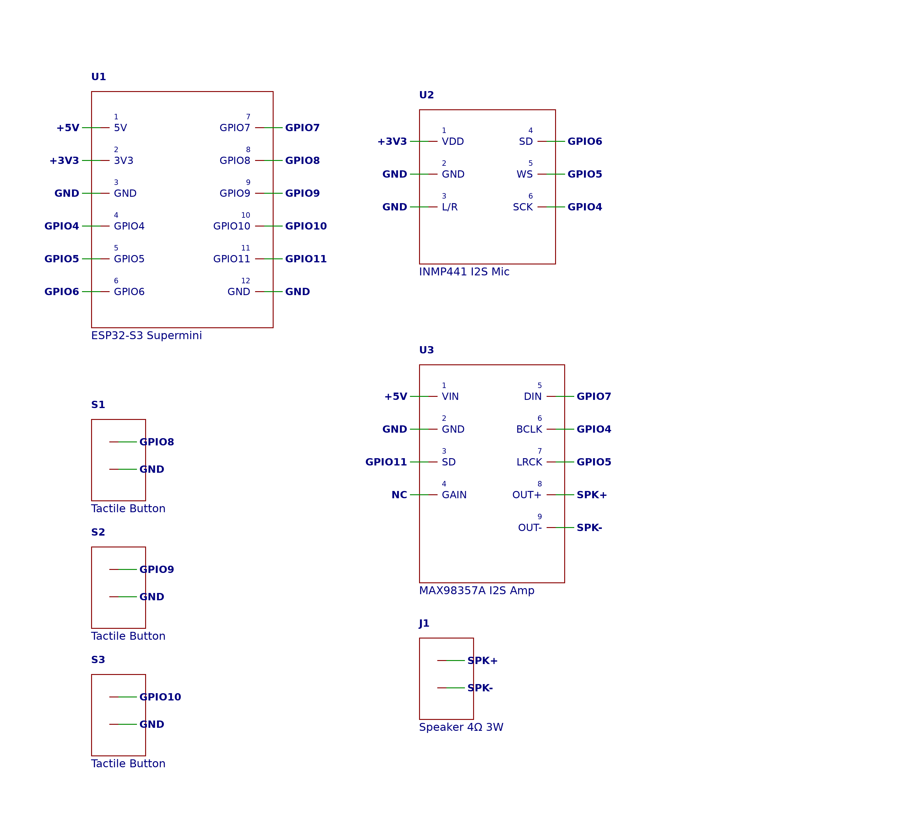
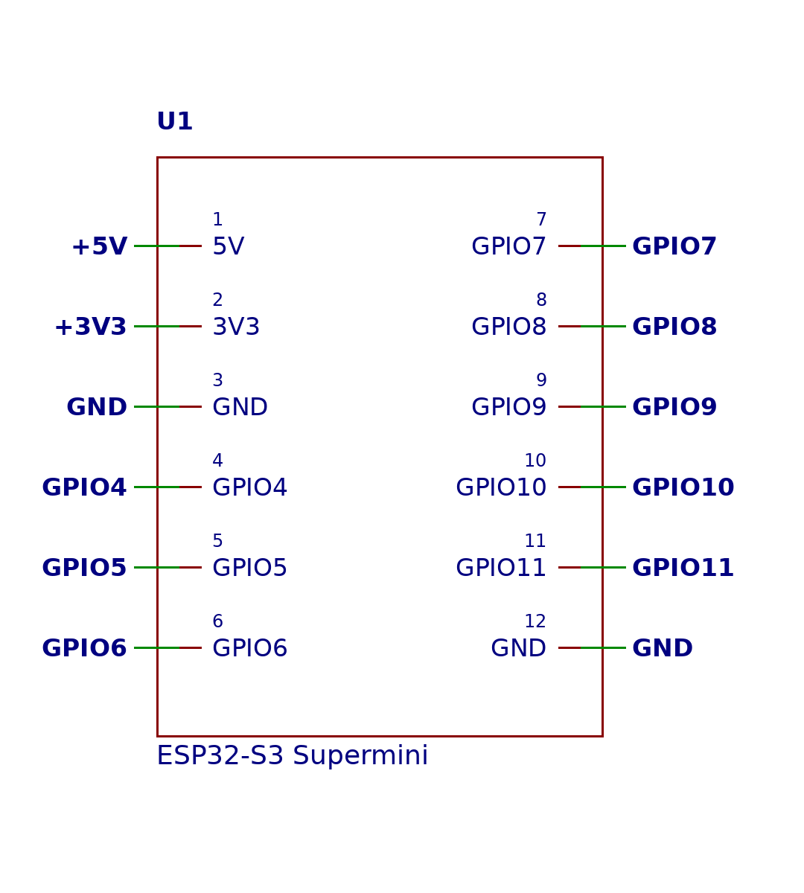

# voice changer

a diy voice changer built around an esp32-s3. talk into the microphone and hear your voice back through a speaker with three different effects: chipmunk, demon, and robot.

the project includes the arduino firmware, hardware design files, and circuit diagrams.

## why

the theme this week is designing an instrument, and i wanted to make one you play with your voice. talk in normally, and it comes back as a chipmunk, a demon, or a robot. it's a simple idea, but making it happen live on a microcontroller is the interesting part.

## voice effects

* chipmunk: shifts your voice up in pitch.
* demon: shifts your voice down in pitch.
* robot: uses ring modulation to give your voice a robotic sound.

each effect can be selected using a physical button.

## hardware

the project currently uses:

* esp32-s3 supermini
* inmp441 i2s microphone
* max98357a i2s amplifier
* speaker
* 3 push buttons
* jumper wires and a suitable power source

## parts and cost

all parts from aliexpress, free shipping.

| part | qty | price |
|---|---|---|
| ESP32-S3 Supermini, pre-soldered (AliExpress) | 2 | $9.56 |
| MAX98357A I2S amp, 2-pack already welded (AliExpress) | 1 | $6.05 |
| INMP441 I2S mic, pre-soldered (AliExpress) | 1 | $5.55 |
| YUXI 4Ω 3W speaker pair (AliExpress) | 1 | $5.33 |
| tactile button kit (AliExpress) | 1 | $4.94 |
| MB-102 breadboard + jumper wires (AliExpress) | 1 | $1.09 |
| **total** | | **$32.52** |

## wiring

the firmware uses the following gpio pins:

| component | esp32-s3 pin |
|---|---|
| i2s bclk | gpio 4 |
| i2s ws | gpio 5 |
| microphone data | gpio 6 |
| amplifier data | gpio 7 |
| chipmunk button | gpio 8 |
| demon button | gpio 9 |
| robot button | gpio 10 |
| amplifier shutdown | gpio 11 |

the microphone and amplifier share the i2s clock lines. the buttons connect between their assigned gpio pins and ground, using the esp32's internal pull-up resistors.

check the schematics and your specific board's pinout before wiring everything together.

## circuit diagrams

the media/ folder contains the circuit diagrams:

* full circuit schematic
* esp32-s3 connections
* microphone connections
* amplifier connections
* button connections

the hardware design is also available in easyeda format.

## getting started

1. install the arduino ide and set up support for esp32 boards.
2. make sure you're using the esp32 arduino core 3.x.
3. open firmware/voice-changer.ino.
4. select your esp32-s3 board and the correct port.
5. enable usb cdc on boot in the tools menu.
6. upload the firmware to the board.
7. open the serial monitor at 115200 baud.

once the hardware is connected, use the three buttons to switch between voice effects.

## how it works

the esp32 reads audio from the inmp441 microphone, processes it, and sends the output to the max98357a amplifier and speaker.

chipmunk and demon modes use a grain-based pitch-shifting algorithm with overlapping audio windows. robot mode uses a 30 hz sine wave to modify the incoming audio and create its robotic effect.

the firmware processes audio at 16 khz and prints the selected mode and a basic input-level meter to the serial monitor.

## project status

this project is currently at the prototype stage. the firmware has been compile-checked, but it has not yet been tested on the physical hardware. microphone gain, audio quality, and wiring may need adjustments during initial testing.

## repository structure

```
voice-changer/
├── firmware/
│   └── voice-changer.ino
├── hardware/
│   └── voice-changer-easyeda.json
├── media/
│   ├── schematic-amp.png
│   ├── schematic-buttons.png
│   ├── schematic-esp32.png
│   ├── schematic-full.png
│   └── schematic-mic.png
└── README.md
```

## Schematic




